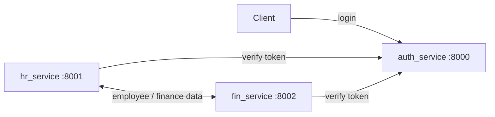

# FIN Service

A Django-based Finance microservice that manages and exposes APIs for financial data. It integrates with external **Auth** and **HR** services and uses multiple databases with custom routing.

---

## 📑 Table of Contents
- [Introduction](#introduction)  
- [Architecture](#architecture)  
- [Features](#features)  
- [Project Structure](#project-structure)  
- [Installation](#installation)  
- [Configuration](#configuration)  
- [Usage](#usage)  
- [API Documentation](#api-documentation)  
- [Dependencies](#dependencies)  
- [Troubleshooting](#troubleshooting)  
- [Contributors](#contributors)  
- [License](#license)  

---

## 🚀 Introduction
This project provides a **Finance Service** that acts as part of a microservices architecture.  
It integrates with:
- **Auth Service** (`http://localhost:8000`) for authentication and token verification  
- **HR Service** (`http://localhost:8001`) for employee data reference  

The project uses **Django REST Framework** and **drf-spectacular** for API schema generation and documentation.

---

## Architecture



The three services run separately; the ports above are the defaults from the example `local_settings.py`. The example configuration uses SQLite for local development. For a gateway-level example (per-field permissions, GraphQL, Redis Streams fan-out), see [graphql-gateway-demo](https://github.com/TaeseobK/graphql-gateway-demo).

## ✨ Features
- **Token-based Authentication** using Auth Service  
- **Integration with HR Service**  
- **Multiple databases**:  
  - `fin_master` – Master financial database  
  - `fin_dump` – Dump/reporting database  
- **Database routing** with custom routers (`FinMasterRouter`, `FinDumpRouter`)  
- **Custom middleware** for Auth validation and logout sync with Auth Service  
- **API Documentation** with OpenAPI schema via drf-spectacular  

---

## 📂 Project Structure
```
fin_service/
│── fin/                   # Django project root
│   ├── settings.py        # Main Django settings
│   ├── local_settings.py  # Environment-specific overrides
│   ├── urls.py            # URL routes
│   ├── wsgi.py            # WSGI entry point
│── fin_master/            # Master database app
│── fin_dump/              # Dump database app
│── fin/core/              # Core logic and utilities
│── databases/             # SQLite databases (default, fin_master, fin_dump)
│── keys/                  # Warning and key files
```

---

## ⚙️ Installation

1. **Clone the repository**
   ```bash
   git clone https://github.com/TaeseobK/fin_service.git
   cd fin_service
   ```

2. **Create and activate a virtual environment**
   ```bash
   python -m venv venv
   source venv/bin/activate   # Linux/Mac
   venv\Scripts\activate      # Windows
   ```

3. **Install dependencies**
   ```bash
   pip install -r requirements.txt
   ```

4. **Create migration files**
   ```bash
   python manage.py makemigrations
   ```

5. **Run database migrations**
   ```bash
   python manage.py migrate
   python manage.py migrate fin_master --database=fin_master
   python manage.py migrate fin_dump --database=fin_dump
   ```

6. **Start the development server**
   ```bash
   python manage.py runserver
   ```

---

## 🔧 Configuration
All sensitive and environment-specific settings are kept in `local_settings.py`.  

Example:
```python
AUTH_SERVICE = 'http://localhost:8000'
HR_SERVICE = 'http://localhost:8001'

DATABASE_SERVICE = {
    'default': {
        'ENGINE': 'django.db.backends.sqlite3',
        'NAME': BASE_DIR / 'databases/auth.sqlite3',
    },
    'fin_master': {
        'ENGINE': 'django.db.backends.sqlite3',
        'NAME': BASE_DIR / 'databases/fin_master.sqlite3',
    },
    'fin_dump': {
        'ENGINE': 'django.db.backends.sqlite3',
        'NAME': BASE_DIR / 'databases/fin_dump.sqlite3',
    }
}

DEBUG_ = True
```

---

## ▶️ Usage
- Access the service at:  
  ```
  http://127.0.0.1:8000/
  ```
- The service requires an **Auth Token** obtained from the **Auth Service**.  
- Pass the token in request headers:  
  ```
  Authorization: Token <your_token>
  ```

---

## 📖 API Documentation
- Swagger/OpenAPI documentation:  
  ```
  http://127.0.0.1:8000/api/schema/swagger-ui/
  ```
- JSON schema:  
  ```
  http://127.0.0.1:8000/api/schema/
  ```

---

## 📦 Dependencies
Key dependencies include:
- **Django 5.2.5**  
- **Django REST Framework**  
- **drf-spectacular** & **drf-spectacular-sidecar**  
- **django-filters**  

---

## 🛠 Troubleshooting
- Ensure **Auth Service** and **HR Service** are running at the correct URLs.  
- Databases must exist under `databases/`. Run `migrate` if missing.  
- Check `DEBUG_` in `local_settings.py` for dev vs production.  

---

## 👥 Contributors
- Afrizal Bayu Satrio (Initial Project and Maintainer)  

---

## 📜 License
This project is licensed under the [Unlicense](LICENSE).  
